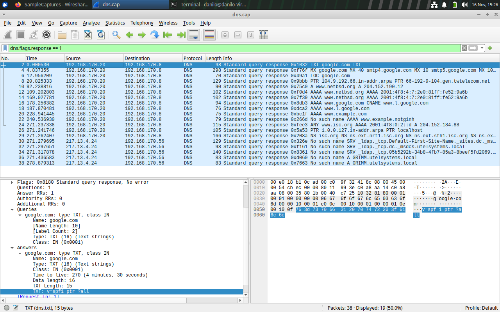
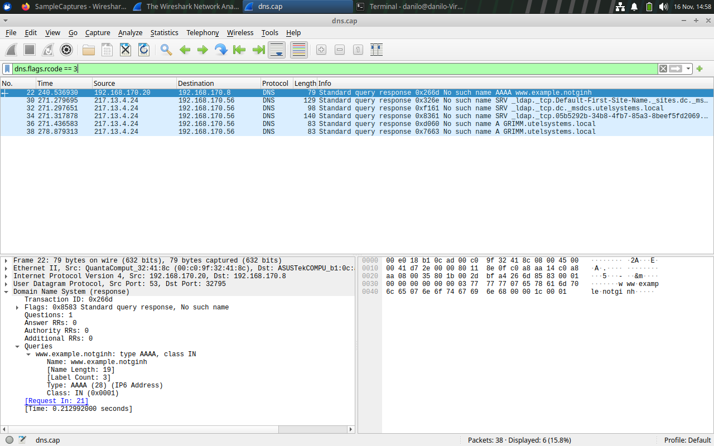

SOC DNS Traffic Analysis Using Wireshark

## 1. Project Overview

This project demonstrates basic network traffic analysis using Wireshark in a controlled virtual laboratory.

The objective was to investigate DNS traffic, identify DNS queries and responses, analyse DNS record types, and recognise successful and unsuccessful DNS lookups.

This project was developed as part of my practical cybersecurity training towards becoming a Junior SOC Analyst.

## 2. Lab Environment

- **Host operating system:** Windows
- **Virtualisation platform:** Oracle VirtualBox
- **Guest operating system:** Xubuntu 24.04 LTS
- **Network configuration:** NAT
- **Analysis tool:** Wireshark 4.2.2
- **Capture file:** `dns.cap`
- **Capture source:** Wireshark Sample Captures

The investigation was performed using a publicly available training PCAP file. No attacks, network scans, or live packet captures were performed.

## 3. Investigation Objectives

- Understand DNS query and response traffic.
- Identify source and destination IP addresses.
- Analyse DNS record types, including TXT and AAAA.
- Identify successful DNS responses.
- Investigate NXDOMAIN responses.
- Practise Wireshark display filters.
- Document technical findings and supporting evidence.

## 4. Methodology

The `dns.cap` sample capture was downloaded from the official Wireshark Sample Captures repository and opened in Wireshark.

The capture contained **38 packets**.

The following display filters were used:

### DNS Queries

dns.flags.response == 0

This filter displays DNS query messages.

### DNS Responses

dns.flags.response == 1

This filter displays DNS response messages.

### NXDOMAIN Responses

dns.flags.rcode == 3

This filter identifies DNS messages reporting that the requested domain name does not exist.

Individual packets were examined using the packet details pane in Wireshark.

## 5. Investigation Findings

Finding 01: Successful DNS TXT Query

A DNS TXT query for `google.com` was identified.

**Packet 1 — DNS Query**

- Source IP: `192.168.170.8`
- Destination IP: `192.168.170.20`
- Destination port: `53`
- Protocol: DNS over UDP
- Domain: `google.com`
- Query type: TXT (16)
- Query class: IN
- Transaction ID: `0x1032`

**Packet 2 — DNS Response**

The corresponding DNS response contained:

- Response status: No error
- Answer records: 1
- Record type: TXT
- TTL: 270 seconds
- TXT content beginning with: `v=spf1`

The TXT record contained SPF-related information, commonly used in email sender authentication.

**Security assessment:** Informational. No malicious activity was established from this DNS exchange.

**Evidence:**

### Finding 02: NXDOMAIN Responses

The filter dns.flags.rcode == 3 identified **6 NXDOMAIN responses** among the 38 captured packets.

NXDOMAIN indicates that the queried DNS name does not exist according to the DNS response.

One example was observed in packet 22:

- Source IP: `192.168.170.20`
- Destination IP: `192.168.170.8`
- Queried name: `www.example.notginh`
- Query type: AAAA
- Response: NXDOMAIN

Other NXDOMAIN responses involved internal-looking DNS names.

Possible explanations include incorrect domain names, missing internal DNS records, or automated service discovery.

**Security assessment:** Requires context. NXDOMAIN responses alone do not establish malicious behaviour.

**Evidence:**

## 6. SOC Analyst Perspective

DNS traffic analysis can help security analysts investigate:

- Unusual domain lookups.
- Repeated DNS resolution failures.
- Unexpected DNS servers.
- Suspicious patterns of DNS queries.
- Potential command-and-control activity when supported by additional evidence.

In this investigation, the available evidence was insufficient to classify any observed activity as malicious.

## 7. Limitations

- The analysis used a small public sample capture containing 38 packets.
- The traffic was not captured from a live production environment.
- No endpoint logs, threat intelligence, or additional network telemetry were correlated.
- DNS activity alone cannot establish whether an attack occurred.
- The results should not be generalised beyond the provided capture.

## 8. Conclusion

This project provided practical experience in examining DNS traffic using Wireshark.

I learned how to distinguish DNS queries from responses, inspect packet fields, identify DNS record types, interpret response codes, and document technical findings.

The investigation identified a successful DNS TXT response containing SPF-related information and six NXDOMAIN responses.

These findings demonstrate foundational network traffic analysis skills relevant to an entry-level Security Operations Centre role.

## 9. References

- Wireshark Sample Captures: https://wiki.wireshark.org/SampleCaptures
- Wireshark User's Guide: https://www.wireshark.org/docs/wsug_html_chunked/
- Wireshark DNS Display Filter Reference: https://www.wireshark.org/docs/dfref/d/dns.html
- RFC 1035 — Domain Names: https://www.rfc-editor.org/rfc/rfc1035
- RFC 7208 — Sender Policy Framework: https://www.rfc-editor.org/rfc/rfc7208

---

**Project type:** Blue Team / SOC Fundamentals
**Tools:** Wireshark, Xubuntu, VirtualBox 
**Skills demonstrated:** Network Traffic Analysis, DNS Investigation, Packet Inspection, Security Documentation